  

  

  

  <!-- GANTI USERNAME DENGAN Rioon7337 -->
  
  
  
   
  
  <!-- Catatan: Kamu belum mengupload file hackster & threads versi wolf, jadi saya pakai yang bawaan dulu atau sesuaikan namanya jika sudah diupload -->
  
  

